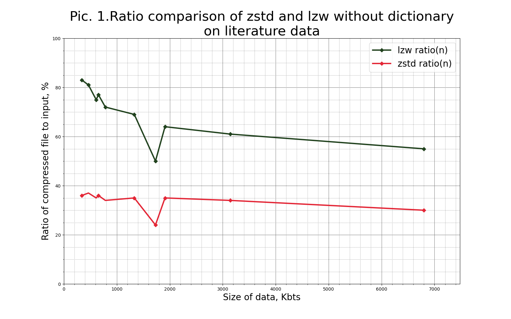
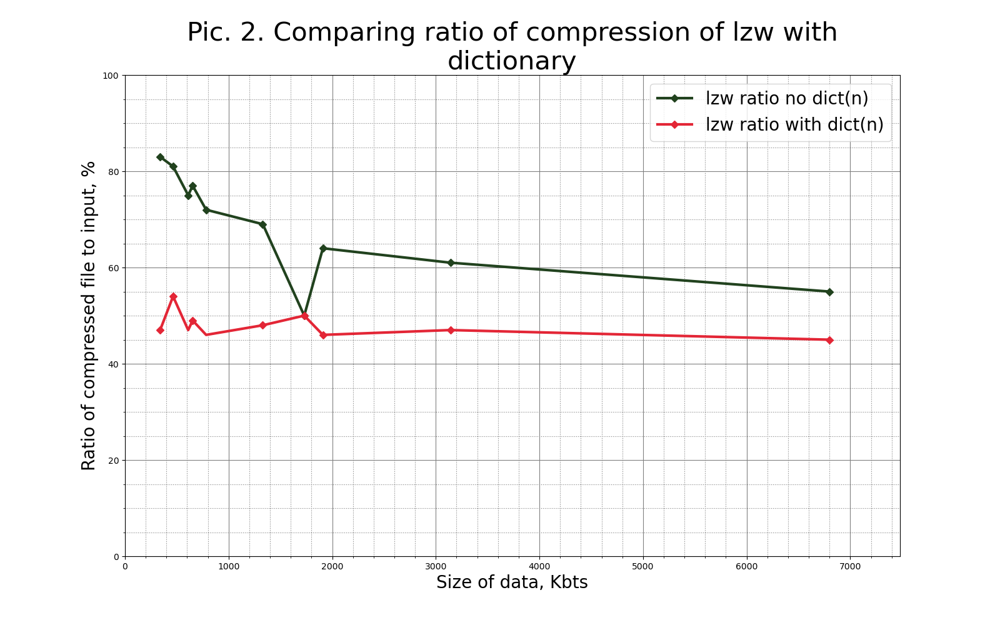
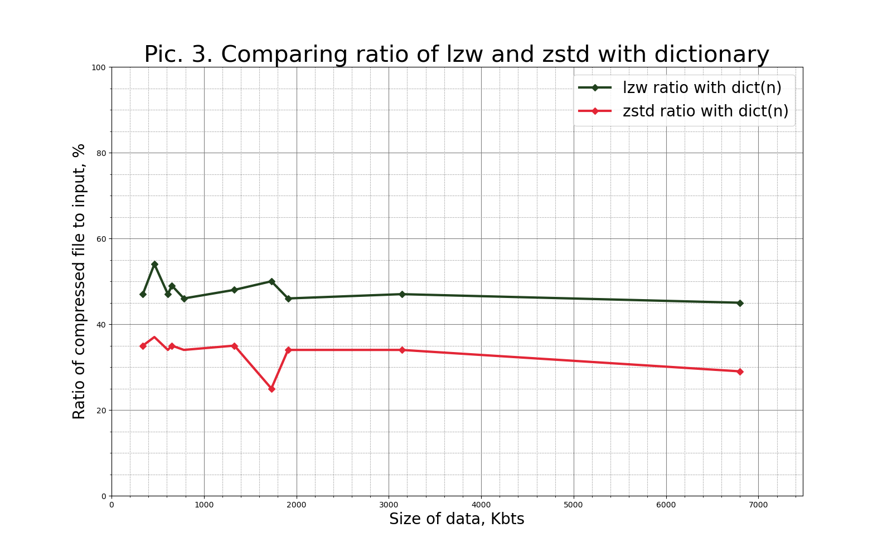
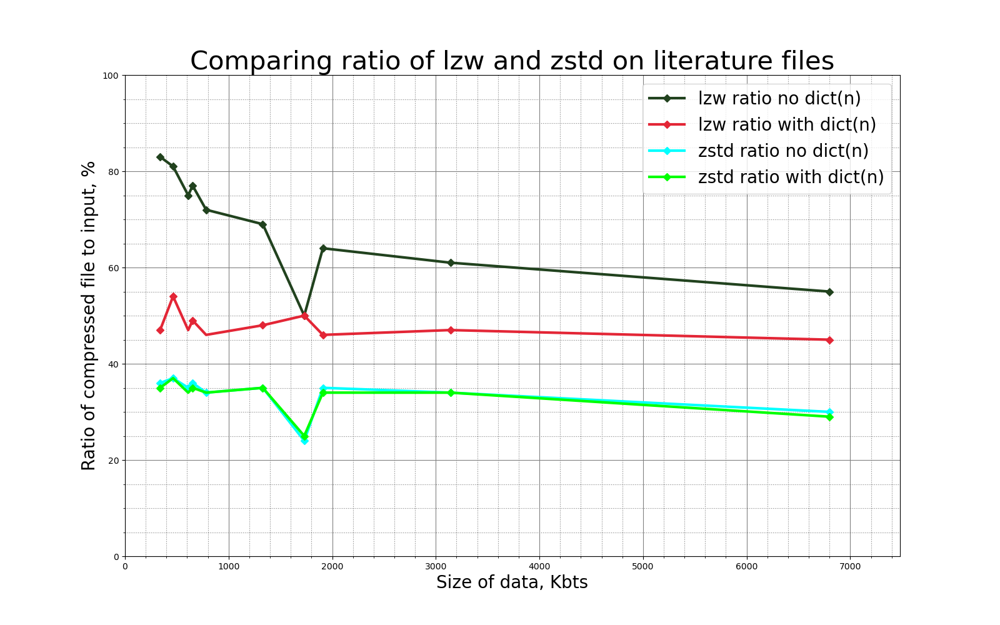
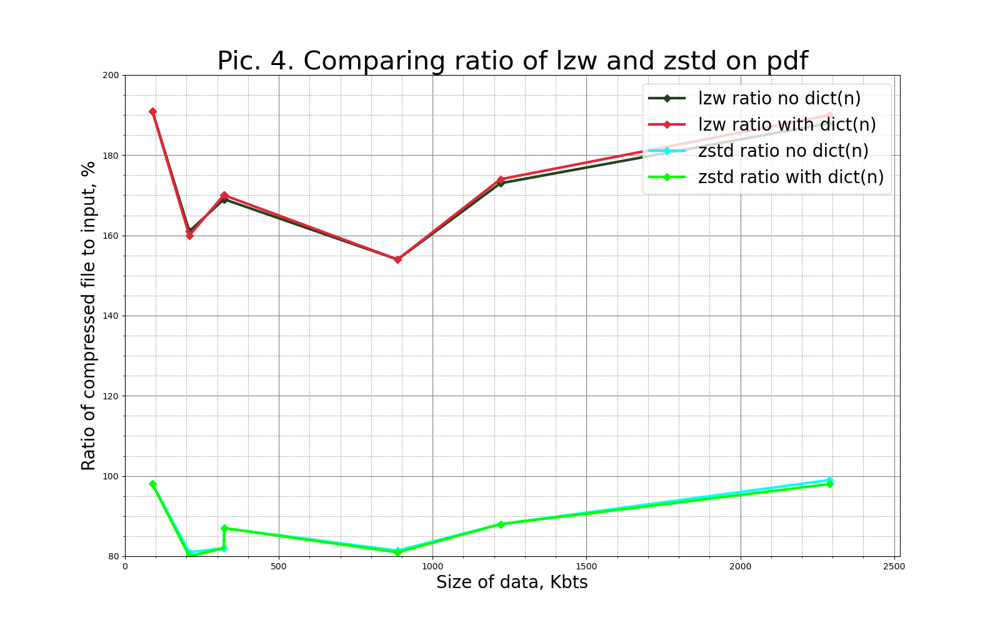
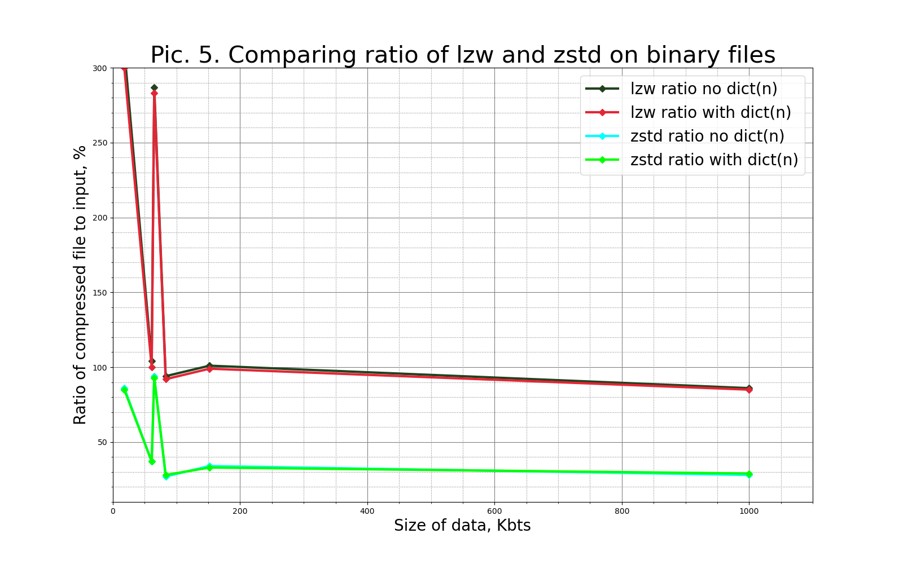

# LZW compressor with trained dictionary

Required programs:

- Cmake version  3.21
- Boost 1.40 program_options

# Install
```
> mkdir build
> cmake ..
> make

```

# Run lzw
```
> mkdir build
> cmake ..
> make
> ./lzw -k [source] [-o destination]

```

# Run unlzw
```
> mkdir build
> cmake ..
> make
> ./unlzw -k [source] [-o destination]

```

## Examples of commands
```
> ./lzw --train true -maxdict=10000  -k ../samples/bin_samples/ -o dict.txt
> ./lzw -f  -D dict.txt -k test.dat -o  ../lzw/dat.lzw
> ./unlzw -k compressed.lzw -o dest.decode

```

### Main options:

```-k [--keep]```   **To scecify source dir**  $\newline$

```-o [--OUTPUT]``` **To scecify destination dir** $\newline$

```--train true```  **To create dictionary(output specification is neccessery available in compress mode), ***SAMPLE SOURCE IS DIRECTORY WRITTEN THIS WAY: dir/***** $\newline$

```-D [--dict]``` **To specify dictionary for compressor(available in compress mode)** $\newline$

```--maxdict``` **To scecify max size of dictionary** $\newline$


# Tests

## There is e2e testing and unit_testing

Required programs:

- Python
- Google tests


### How to run end to end tests that check quality of compression and check sha1hash?
Run this command from build directory
```
> python ../tests/end_to_end_tests/e2e_tests.py

```

### How to run end to end tests compare zstd and lzw compressing?
Run this command from build directory
```
> python ../tests/end_to_end_tests/compress_runner.py

```


---
<h1 align="center">Comparison of LZW and ZSTD compressors</a></h1>


<h2 align="center">Classic literature files compression without dictionary</a></h2>

<p align="center">
  
</p>

<h2 align="center">Classic literature files compression with dictionary</a></h2>

<p align="center">
  
</p>

<p align="center">
  
</p>

<p align="center">
  
</p>

<h2 align="center">PDF files compression</a></h2>

<p align="center">
  
</p>

<h2 align="center">BIN files compression</a></h2>

<p align="center">
  
</p>


# Conclusion:

